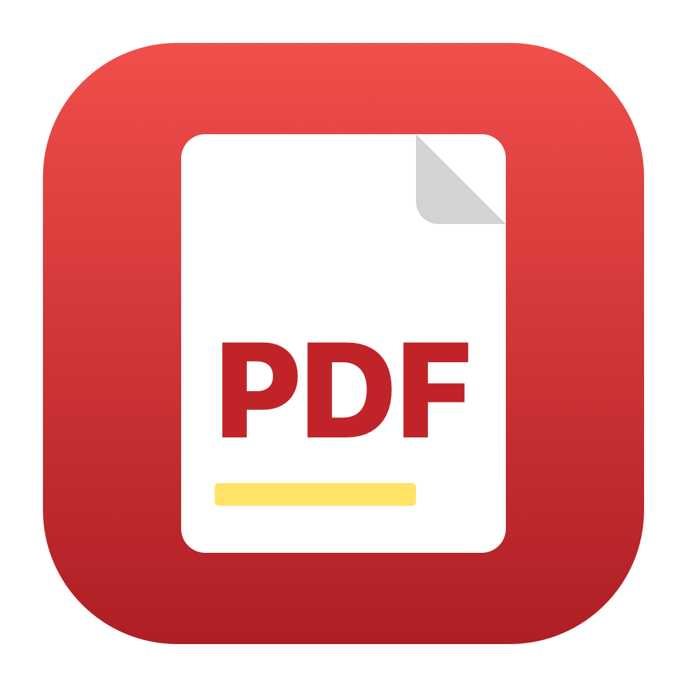

<p align="center"></p>

# mPDF

A fast, lightweight PDF reader and editor for macOS, built for reading first and filling in templates quickly.

🇬🇧 English · 🇫🇷 [Français](#français)

## About

mPDF is made by Starbudweiser & Claude Code (Anthropic). MIT License, © 2026 Starbudweiser. Provided as is, without warranty. Inspired by Skim, not affiliated with its authors. See "About mPDF" in the app menu.

## Features

- Reader mode: the window takes the shape of the page, the page fills it edge to edge, and the toolbar slides in from the top on demand (pointer at the top edge, two-finger swipe down on the first page, or ⌥⌘T).
- Pages panel (thumbnails and outline) that slides over the page, on the left or on the right.
- Drag and drop PDF files or images into the pages panel to insert them between two pages, or onto a page to place an image or insert pages before/after it. Reorder, duplicate, rotate, delete pages, insert blank pages.
- Fill in forms; add text, check marks, images, shapes, arrows, freehand drawing, notes, highlights; white-out to hide existing text. Everything added can be moved, resized and undone.
- Search, bookmarks of the last position, full screen and presentation mode.
- Interface follows the Socle design system. English, French, Spanish and Italian.
- Automatic updates from GitHub releases (daily check, Developer ID signature verified), with an "install automatically" option and a manual check in the settings.

## Install

Download the latest `.zip` from [Releases](https://github.com/starbudweiser/mPDF/releases/latest), unzip and move `mPDF.app` to your Applications folder. The app is signed and notarized. macOS 14 or later.

## Build

```bash
./build_app.sh          # signed local build, installed in ~/Applications/Applications Personnelles
DEV=1 ./build_app.sh    # development edition (mPDF DEV.app)
```

## Français

mPDF est un lecteur et éditeur PDF rapide et léger pour macOS : lecture d'abord (la page remplit la fenêtre, la barre d'outils glisse à la demande), puis remplissage de modèles (texte, coches, images, formes), ajout de PDF ou d'images par glisser-déposer entre deux pages. Voir « À propos de mPDF » dans le menu de l'appli.
